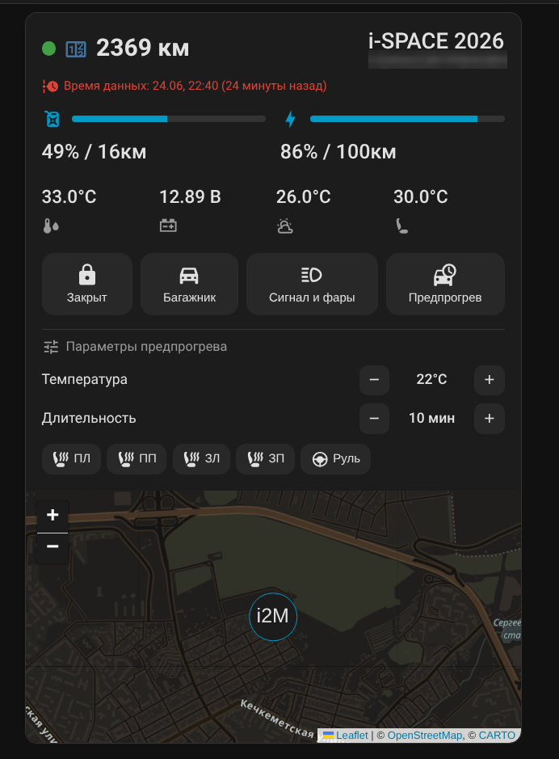

# Evolute Card

[](https://github.com/hacs/integration)
[](https://www.home-assistant.io/)

Универсальная Lovelace-карточка для интеграции
**[evolute-ha](https://github.com/Tamahome-M/evolute-ha)** (Evolute / evassist).
Показывает состояние автомобиля и даёт управление прямо с дашборда.

Карточка **сама находит устройство Evolute** и сопоставляет сущности по их
`translation_key`, поэтому работает на любой машине и в любой локали — править
`entity_id` руками не нужно.

> ⚠️ **Требуется интеграция [evolute-ha](https://github.com/Tamahome-M/evolute-ha) версии 1.2.21.**
> Без неё карточке нечего показывать — сущности автомобиля создаёт именно интеграция.

## Скриншот

<!-- Замените на реальный скриншот карточки перед публикацией -->


## Возможности

- Одометр + индикатор онлайн, модель и VIN. Перед индикатором связи — значок сети и уровень сигнала в процентах; нажатие открывает датчик HA. Если данных нет, показывается «—%».
- Полосы заряда батареи и топлива с остатком хода. Строка батареи: **температура ВВБ / процент / километры**. Каждое значение открывает историю своего датчика.
- Когда зарядный пистолет вставлен, его значок заменяет шарик онлайн рядом с пробегом. Цвет сохраняет индикацию связи; значок обозначает подключённый разъём.
- Когда автомобиль онлайн и не в паркинге, вместо кружка отображается машина с подсказкой «В пути». При возврате в паркинг снова показывается кружок; значок вставленного зарядного пистолета имеет приоритет.
- Температуры (ОЖ, снаружи, в салоне) и напряжение 12В.
- Управление: центральный замок, багажник, сигнал и фары («Поиск» — звук +
  моргание), обогрев, охлаждение и подготовка к поездке (вкл/выкл).
- Обогрев и охлаждение используют команды нового API; при включённом режиме
  карточка предлагает его выключить. Старый предпрогрев и панель его параметров удалены.
- Строка «Время данных» — когда машина в последний раз прислала телеметрию.
- Опциональная карта местоположения.
- Подтверждённые статусы команд: **Отправлена → Доставлена → Выполнена**, ошибки и отсутствие подтверждения. Пока выполняется команда, повторные нажатия заблокированы.
- Отдельная кнопка подготовки к поездке по профилю сайта и сообщения о несовпадении прошивки или настроек с профилем.

## Установка через HACS

[](https://my.home-assistant.io/redirect/hacs_repository/?owner=Tamahome-M&repository=evolute-card&category=dashboard)

1. HACS → три точки → **Custom repositories**.
2. URL: `https://github.com/Tamahome-M/evolute-card`, категория **Dashboard**.
3. Найдите «Evolute Card», нажмите **Download**, обновите страницу (Ctrl+F5).

HACS сам добавит ресурс. Если добавляете `.js` вручную (без HACS):
**Настройки → Панели → ⋮ → Ресурсы →** добавить
`/hacsfiles/evolute-card/evolute-card.js` как **JavaScript-модуль**.

## Использование

Минимально — карточка сама найдёт машину:

```yaml
type: custom:evolute-card
```

Со всеми опциями:

```yaml
type: custom:evolute-card
show_map: true        # показать карту местоположения (по умолчанию выкл.)
map_height: 250       # высота карты, px
device: abcd1234...   # device_id — только если у вас несколько машин Evolute
```

### Несколько автомобилей

Если интеграция добавлена для нескольких машин, укажите `device` (его `device_id`
есть в URL страницы устройства: **Настройки → Устройства → ваша машина**).

## Требования

- Интеграция **[evolute-ha](https://github.com/Tamahome-M/evolute-ha)** 1.2.21.
- Home Assistant 2024.1 или новее.

## Лицензия

MIT

## Проверки

`npm ci --ignore-scripts && npm test` запускает проверки поведения. Тестовые состояния в `tests/fixtures/ha-current.json` записаны из настоящих платформ и службы замка Home Assistant с интеграцией 1.2.20b0; запросы к EVAssist подменены.

CI также проверяет карточку в Chromium на ширинах 520 и 360 px: раскладку, замену индикатора разъёма, статусы команд и единственный вызов службы при нажатии. Снимки сохраняются в артефактах. Рендер значков HA заменён в этих снимках, их размеры сохранены.

Карточка и интеграция выпускаются вместе как **v1.2.21**. Обновите оба компонента через HACS, перезапустите HA после обновления интеграции и обновите страницу браузера.
